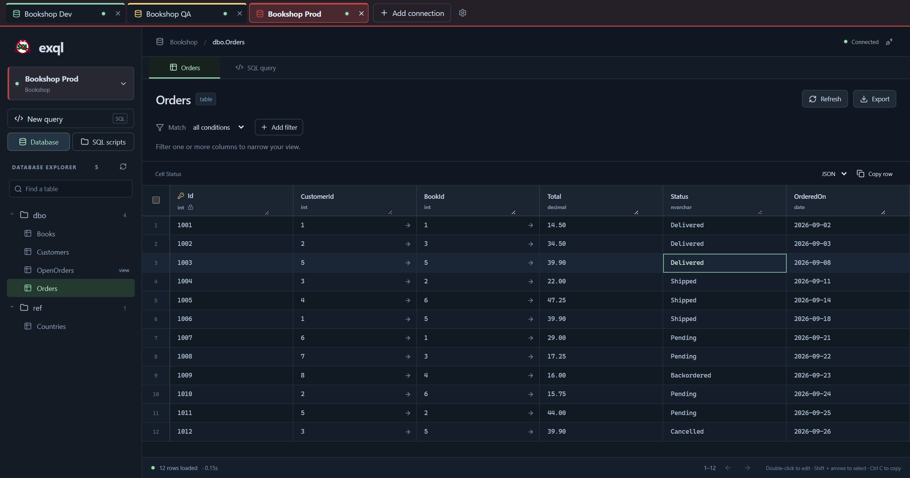
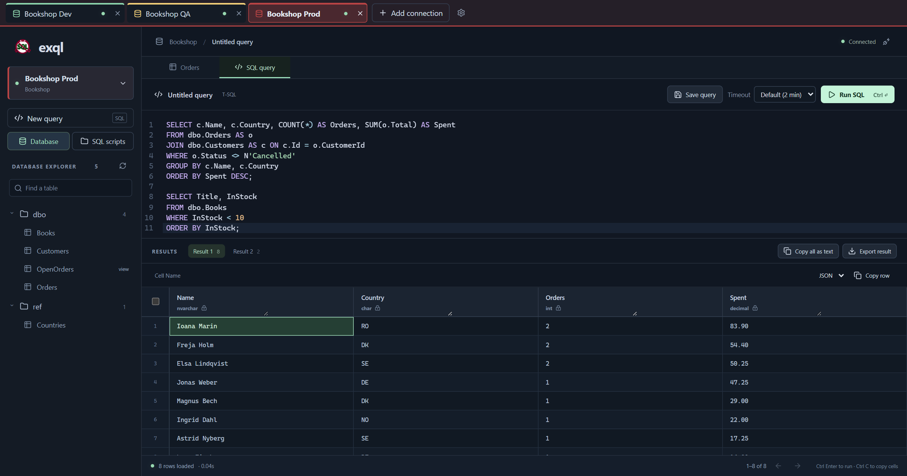
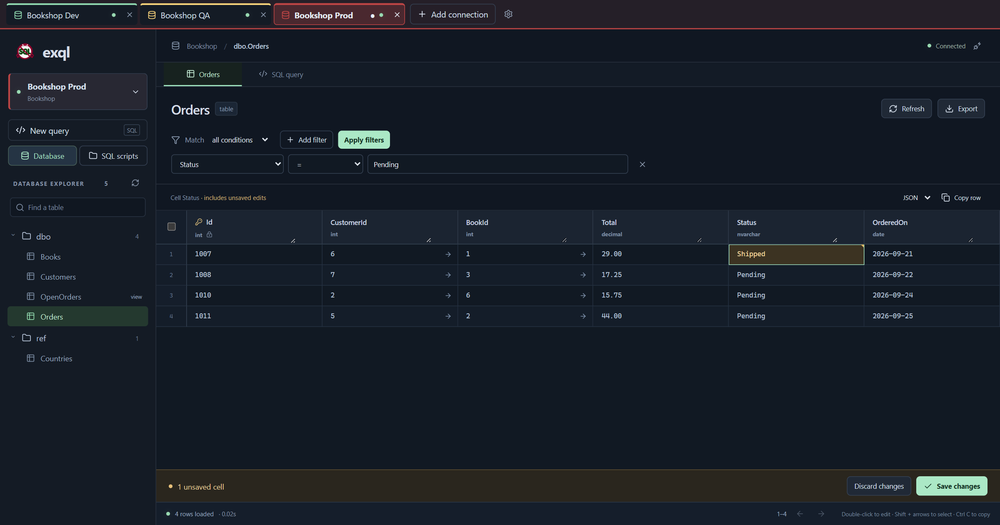
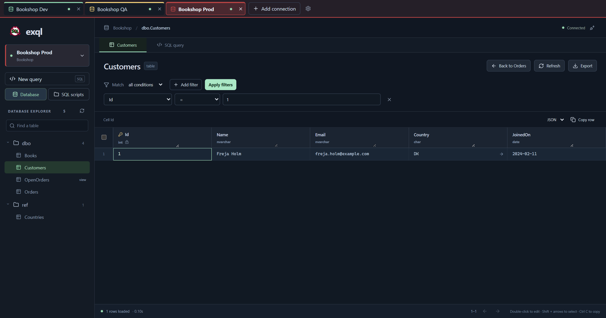
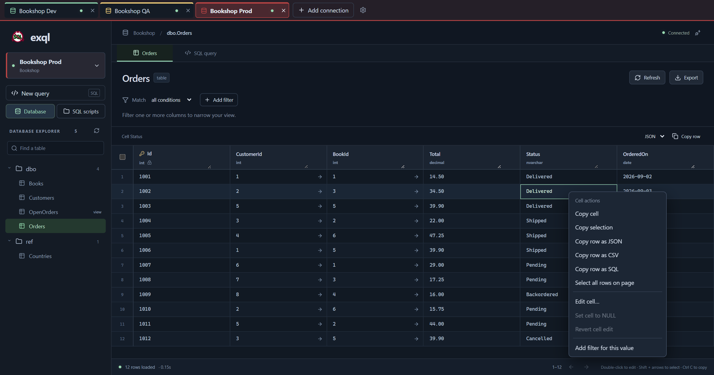
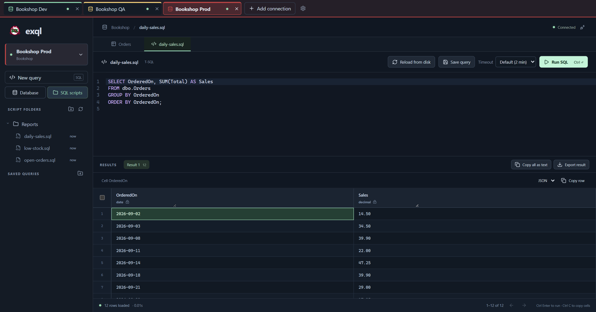
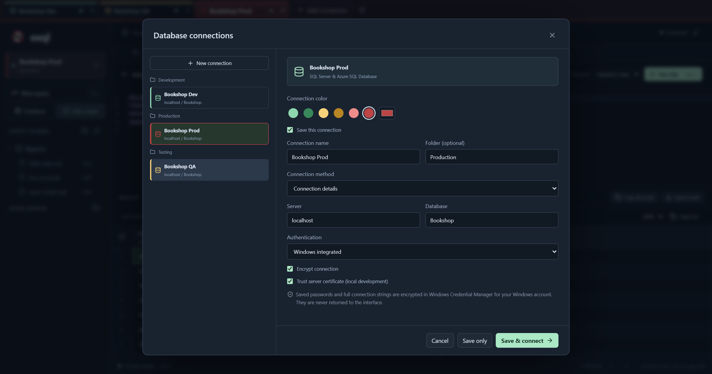

  

<h1 align="center">ExQL</h1>

  <strong>A spreadsheet-style data grid and a SQL editor for SQL Server and Azure SQL, in a portable Windows app.</strong>

  
  
  
  

  

## Why

- **Nothing to install.** Unzip and run. No installer, administrator rights, Node.js or .NET needed.
- **Data you can handle like a spreadsheet.** Select ranges, copy them, and edit cells in place. Edits are staged, so you review them before they are committed in one transaction.
- **You can see which database you're on.** Give each connection a color. The open connection tints its tab and the top bar, so Prod doesn't look like Dev.

## A quick tour

<table>
  <tr>
    <td width="50%"></td>
    <td width="50%"></td>
  </tr>
  <tr>
    <td><strong>Run T-SQL.</strong> Run a script or just the selection with Ctrl+Enter, with <code>GO</code> batches and a tab per result set.</td>
    <td><strong>Review edits before they land.</strong> Filter, edit, then save the batch in a transaction or discard it.</td>
  </tr>
  <tr>
    <td></td>
    <td></td>
  </tr>
  <tr>
    <td><strong>Follow foreign keys.</strong> An arrow opens the referenced row, and Back restores your filters, sort and page.</td>
    <td><strong>Right-click everything.</strong> Copy cells and rows as JSON, CSV or SQL, edit, set NULL or filter by a value.</td>
  </tr>
  <tr>
    <td></td>
    <td></td>
  </tr>
  <tr>
    <td><strong>Your scripts, from disk.</strong> Link a folder and run its <code>.sql</code> files. ExQL only reads them.</td>
    <td><strong>Saved connections.</strong> Named, colored and grouped into folders, with passwords kept in Windows Credential Manager.</td>
  </tr>
</table>

## Features

- **Data grid.** Keyboard navigation, range selection, column filters, sorting and paging through tables and views.
- **Safe editing.** Staged cell edits on tables with a primary key. Concurrent changes are detected, and a conflict rolls back the whole batch.
- **Copy and export.** Copy as JSON, CSV or SQL, or export whole tables and query results. Large integers and decimals keep their exact digits.
- **Paste into an AI chat.** **Copy all as text** puts a run's result sets, messages and error into one plain-text block.
- **Several databases at once.** Each tab keeps its own table, filters, edits, SQL and results, and tabs come back after a restart.
- **Saved queries.** Organize queries in folders. Closed tabs' SQL is kept as files you can reopen.
- **Authentication.** Windows, SQL login and Microsoft Entra interactive, or paste a full connection string.
- **Automatic updates.** New versions download in the background and only apply when you click **Restart to update**.
- **Local only.** No telemetry. The app's API listens on a random loopback port and requires a per-launch token.

## Install

1. Download `ExQL.Desktop-win-x64-Portable.zip` from the [latest release](https://github.com/oana-ffg/exql/releases/latest).
2. Extract the **entire ZIP** into a folder you can write to.
3. Open `ExQL.exe` in the root of that folder. Keep the updater and `current` folder beside it.

ExQL needs Microsoft WebView2, which other Windows machines must have available.

> [!NOTE]
> ExQL is **pre-1.0** and unsigned, so Windows may warn you the first time you open it. CI tests against SQL Server 2019, 2022 and 2025. Live Azure SQL and Entra sign-in are not covered by automated tests.

## Quick start

1. Click **Connect to database** and enter the server, database and authentication.
2. For Azure SQL, use the server's hostname, keep encryption on and leave certificate trust off. The server's firewall must allow your connection.
3. Open a table from the explorer, or click **New query** and press Ctrl+Enter to run SQL.

SQL runs with your database permissions. ExQL doesn't make a connection read-only, so use a read-only login where that matters.

## Documentation

- [Using ExQL](docs/usage.md): the grid, editing, the SQL editor, script folders, connections and updates
- [Data and security](docs/data-and-security.md): where credentials and data are stored, and how the local API is protected
- [Development](docs/development.md): building, testing, releasing and regenerating screenshots

MIT licensed. Independent of TablePlus.
